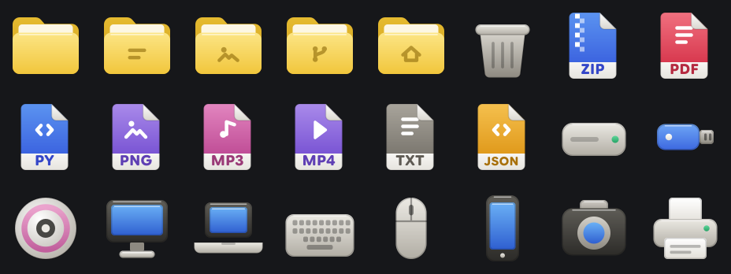

# Citropy KDE theme

A look for KDE Plasma 6 based on the Citropy app. It changes the interface font, the icons, the pointer and the wallpaper. Colors, window frames and widget style stay as they are.



## What it contains

| Part | What it does |
| --- | --- |
| `fonts/` | Citropy Sans, used for the interface, menus, toolbars and window titles. |
| `icons/Citropy` | Icon theme. Redraws folders, 520 file types and 60 device icons in one smooth style. Everything else falls back to Breeze Dark. |
| `cursors/Citropy-Cursors` | Cursor theme. The default arrow is Citropy, other pointers fall back to Breeze. |
| `wallpapers/citropy.png` | 2560x1440 wallpaper with the Citropy mark. |

File icons follow one layout. A colored page carries a symbol, and a label strip at the bottom shows the extension (ZIP, PDF, PNG, JSON). Colors group by family, for example blue for archives and documents, purple for images and video, green for spreadsheets.

Toolbar and status icons, app icons and the panel launcher are not changed.

## Install

Needs Plasma 6 (`kwriteconfig6`) and `fc-cache`.

```
git clone https://github.com/tinuxongit/citropy-kde-theme
cd citropy-kde-theme
./install.sh
```

Add `--wallpaper` to also set the wallpaper. Log out and in afterwards so running apps pick up the font and icons.

The installer saves your previous font, icon theme and cursor theme to `~/.config/citropy-kde-theme/previous.conf` before changing them.

## Uninstall

```
./uninstall.sh
```

This restores the saved settings and removes everything the installer copied. If you applied the wallpaper, it stays until you choose another one.

## Licenses

- Icons, cursor, scripts: MIT, see `LICENSE`.
- Citropy Sans is a modified version of Google Sans Flex under the SIL Open Font License 1.1, see `fonts/CitropySans-OFL.txt`.
- The Citropy mark in the wallpaper belongs to the Citropy project.
